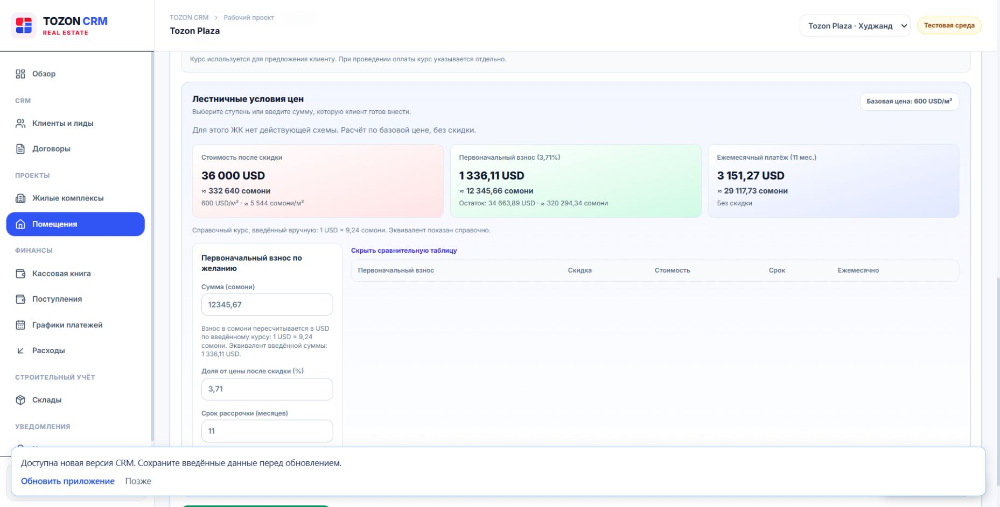

# Stage 27 — Live release notification and draft preservation

Follow-up: [Stage 28](COMPANY_PROJECTS_STAGE_28.md) closes the exact `/login` cache-policy gap below and records the 2026-11-26 test Plaza isolation/readiness audit.

## Result

On 2026-11-21, the existing isolated test frontend commit `c93886586a3a445e99c6e7fd70f17339182ed78b` was rebuilt without a source change. Deploy `dep-dc0n18p7lnhs7395sst0` reached `live`. The public build changed from `dae973f3191edf691858ea6a1042d025` to `2e210d935487ff0545aa908dfa8592ef`.

The connected Chrome session loaded the old build as the existing Test Plaza employee. In Tozon Plaza → Inventory → demo apartment 101, a draft calculator contained rate 9.24, deposit 12345.67 TJS and term 11 months. The release notification appeared with the exact new public build ID. The loaded page retained its old build ID, open apartment card and all three input values. Clicking Later removed the notification while retaining the same card and values. No deal, payment, expense or other business form was submitted. The test used the calculator; explicit reload and recovery of unsaved forms across reload were not tested or promised.

## Cache configuration

The four rules previously entered by the user in the test Render Dashboard were independently verified over public HTTP both before and after the rebuild: `/`, `/index.html`, `/crm-version.json` and `/sw.js` return status 200 and `Cache-Control: no-store`. Root HTML, index HTML and version JSON agree on the new build ID after deploy.

The same four rules are now recorded in `deployment/project-pilot.render.yaml` under the existing static test service. No environment variables, API settings, resource names, service plans, routes or automatic-deploy settings were changed. No separate Blueprint sync was requested. Render's current Blueprint specification says header rules omitted from a Blueprint are preserved; the source addition records the intended policy rather than claiming omitted rules would necessarily be removed.

YAML passed validation against the current public Render JSON Schema and `git diff --check`. The Render CLI is not installed, so platform-aware CLI validation was not performed. Current official Blueprint/deploy/health-check references were retrieved and the relevant sections read. Static sites do not use web-service health checks; the test API independently responded in isolated-project-pilot mode with external sends disabled.

## Scope and limits

- Production, main branches, database contents, real employees and external communications are unchanged. The API was not redeployed. Test automatic deployments remain off.
- The draft existed only in the browser and the page was left open for review. Its values are not a financial transaction or stored business record.
- `/login` still returns `public, max-age=0, s-maxage=300`: the four exact-path rules do not cover every SPA URL. That route was served with the correct build during this check, but this stage does not claim a complete site-wide cache policy.
- The update banner and Later behavior are now verified in the live test browser, superseding the outstanding browser-check limitation in Stage 26. This does not establish production launch readiness.

Public response and browser metadata: [verification record](qa/company-project-cache-release.json).
